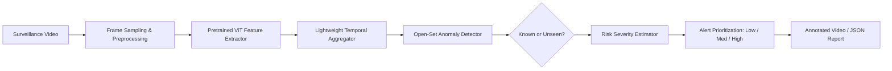

# Vision Transformer-Based Open-Set Video Anomaly Detection with Risk Severity Estimation

[](https://www.python.org/)
[](https://pytorch.org/)
[](LICENSE)

An intelligent, lightweight surveillance video anomaly detection framework combining **Pretrained Vision Transformers (ViT)**, **Temporal Behavior Aggregation**, **Open-Set Anomaly Identification (Known vs. Unseen)**, and **Multi-Tier Risk Severity Prioritization (Low / Medium / High)**.

---

## 📌 1. Project Overview

Surveillance operations suffer from operator alert fatigue caused by monitoring dozens or hundreds of camera feeds simultaneously. Existing AI systems often struggle when faced with novel, unseen anomaly types not included in training data, or overwhelm guards with flat binary ("anomaly" / "normal") alarms without operational context.

This project addresses these challenges with a 4-pillar design:
1. **Pretrained Vision Transformer (ViT)**: Reuses state-of-the-art vision models (`timm` ViT backbones like `vit_base_patch16_224` or `vit_tiny_patch16_224`) for expressive spatial feature extraction without training large models from scratch.
2. **Lightweight Temporal Aggregation**: Aggregates multi-frame temporal dynamics using lightweight GRU / Temporal Convolution modules rather than computationally heavy 3D-CNNs (like C3D or I3D).
3. **Open-Set Experimentation**: Separates anomalies into **Known** (seen during training/fine-tuning) and **Unseen** (withheld during training), evaluating the model's true open-world generalization capability.
4. **Risk Severity Prioritization**: Computes a calibrated operational risk score categorized into **Low**, **Medium**, or **High** priority based on anomaly deviation magnitude, temporal persistence, and detector uncertainty.

---

## 🏗️ 2. System Architecture



### Baseline vs. Proposed System
| Component | Baseline | Proposed System |
|---|---|---|
| **Visual Backbone** | Pretrained ViT (Single Frame) | Pretrained ViT (Frozen / Fine-tuned) |
| **Temporal Representation** | Basic / None | Explicit lightweight Temporal Aggregator (GRU/TCN) |
| **Open-Set Evaluation** | Closed-set only | Controlled Known vs. Unseen category splits |
| **Operational Output** | Binary (Normal / Anomaly) | Status + Known/Unseen + Risk Priority (Low/Med/High) |
| **Efficiency Focus** | Baseline frame rate | Explicit throughput (FPS) & FLOPs benchmarking |

---

## 🔬 3. Research Positioning & Scope Boundary

> [!IMPORTANT]
> **What We Claim:**
> - A computationally efficient, end-to-end surveillance pipeline leveraging off-the-shelf ViT features with lightweight temporal modeling.
> - Rigorous open-set evaluation quantifying how well the detector generalises to withheld anomaly categories.
> - A practical multi-tier risk-severity framework to mitigate surveillance alert fatigue.
> - Comprehensive speed vs. accuracy trade-off profiling for edge/campus surveillance feasibility.

> [!CAUTION]
> **What We Do NOT Claim:**
> - We did not invent Vision Transformers or self-attention.
> - Open-set anomaly detection as a raw concept is already established (e.g., RSOB + HPF, UBnormal).
> - We do not claim superior performance over massive multi-modal foundation models before experimental validation.

See [`docs/literature_gap_analysis.md`](docs/literature_gap_analysis.md) for the complete literature review and gap verification.

---

## 📂 4. Repository Structure

```text
vit-open-set-video-anomaly/
├── configs/
│   └── default_config.py           # Configuration parameters (ViT backbone, thresholds, data)
├── docs/
│   └── literature_gap_analysis.md  # Detailed literature review & gap analysis
├── src/
│   ├── __init__.py
│   ├── data/                       # Video sampling and open-set dataset loaders
│   │   ├── __init__.py
│   │   ├── frame_sampler.py        # Frame extraction & normalization
│   │   └── openset_split.py        # Known vs. unseen category partitioner
│   ├── models/                     # Core neural network modules
│   │   ├── __init__.py
│   │   ├── vit_extractor.py        # Pretrained ViT feature extractor
│   │   ├── temporal_aggregator.py  # Lightweight GRU/TCN temporal aggregator
│   │   ├── openset_detector.py     # Open-set anomaly scoring & decision logic
│   │   └── risk_estimator.py       # Risk severity calculator (Low/Med/High)
│   ├── eval/                       # Metrics & benchmarking
│   │   ├── __init__.py
│   │   ├── metrics.py              # ROC-AUC, PR-AUC, FPR, F1, Confusion Matrix
│   │   └── efficiency.py           # Latency, FPS, and parameter counting
│   ├── inference/                  # End-to-end pipeline & video annotator
│   │   ├── __init__.py
│   │   ├── pipeline.py             # Video inference pipeline
│   │   └── video_annotator.py      # OpenCV bounding-box & banner overlays
│   └── utils/
│       ├── __init__.py
│       └── logger.py               # Structured output and logging utilities
├── scripts/
│   ├── demo_inference.py           # Test video inference runner
│   ├── run_evaluation.py           # Benchmark evaluation on test sets
│   └── benchmark_speed.py          # FPS and latency measurement
├── requirements.txt                # Python dependencies
└── README.md                       # Main documentation
```

---

## ⚡ 5. Quickstart & Deployment

### Prerequisites
- Python 3.10 or 3.11
- NVIDIA GPU with CUDA support (Recommended) OR standard CPU

### Step 1: Clone Repository
```bash
git clone [https://github.com/<your-username>/vit-open-set-video-anomaly](https://github.com/rukeshbabugantla143/ViT-Open-Set-Video-Anomaly-Detection-Risk-Estimator).git
cd vit-open-set-video-anomaly
```

### Step 2: Create & Activate Virtual Environment
```powershell
# Windows PowerShell
python -m venv .venv
.\.venv\Scripts\Activate.ps1

# Install Dependencies
pip install -r requirements.txt
```

### Step 3: Run Interactive Web Dashboard
Run the Streamlit operations dashboard with a single command:
```powershell
streamlit run app/streamlit_app.py
```
*Or double-click:* `run_dashboard.bat` (Windows Command Prompt) or execute `.\run_dashboard.ps1` (PowerShell).

Access the interactive dashboard in your browser at: **`http://localhost:8501`**

### Step 4: Run CLI Inference (Optional)
```powershell
python scripts/run_cli.py infer --video-path path/to/video.mp4 --checkpoint checkpoints/my_custom_scene.pt --output-dir outputs/demo
```

---

## 📊 6. Expected Output Format

The inference engine yields both structured JSON events and an annotated surveillance video:

```json
{
  "timestamp": "00:02:14",
  "frame_range": [3210, 3270],
  "anomaly_detected": true,
  "category_type": "Unseen Anomaly",
  "anomaly_score": 0.874,
  "risk_severity": "High",
  "risk_breakdown": {
    "deviation_score": 0.88,
    "persistence_score": 0.92,
    "confidence": 0.85
  },
  "recommended_action": "Immediate Security Dispatch"
}
```

---

## 📖 7. Citation & References
1. **RSOB + HPF (2026)**: *Enabling Real-World Supervised Video Anomaly Detection: New Open-Set Benchmark and New Framework*.
2. **UBnormal (CVPR 2022)**: *UBnormal: New Benchmark for Open-Set Video Anomaly Detection*.
3. **ViT (ICLR 2021)**: *An Image is Worth 16x16 Words: Transformers for Image Recognition at Scale*.
4. **Sultani et al. (CVPR 2018)**: *Real-world Anomaly Detection in Surveillance Videos (UCF-Crime)*.
